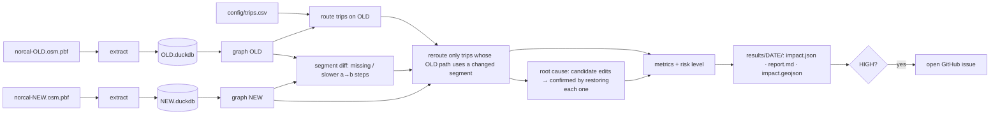
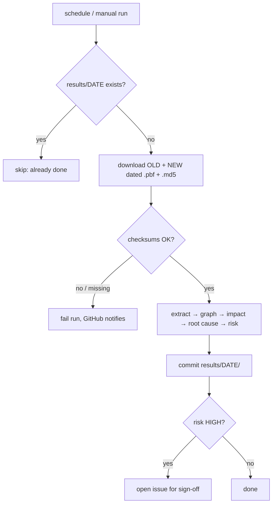

# route-impact — Design

**Status:** agreed design, 2026-10-28 · **Owner:** Jared Narvaez · **Plan:** [PLAN.md](../PLAN.md)

> Numbers in this doc marked *(exploration)* come from ad-hoc DuckDB queries run on 2026-10-28 against Geofabrik's Northern California extracts while designing. They are design evidence, **not** README or resume numbers — those must come from `results/` files produced by the tool.

---

## 1. Abstract

`route-impact` measures how a day of OpenStreetMap edits changes navigation in Northern California. Every day it downloads two consecutive Geofabrik snapshots, turns each into a road network, routes a fixed set of trips on both (population-weighted city-to-city trips plus a fixed sample of local trips), and reports which trips broke or got slower. For each affected trip it names the road edit that caused it. The result is a risk level (LOW / MEDIUM / HIGH), a committed daily report, and a static map of affected routes; HIGH opens a GitHub issue for a human to sign off. Because real breakages are rare, the tool is also evaluated by **fault injection**: deliberately breaking real roads (deleting a bridge, flipping a one-way, disconnecting an intersection) and measuring whether it finds the right culprit.

One-sentence story: *"I built a daily pipeline that measures how map edits change navigation across Northern California — it routes thousands of population-weighted trips on consecutive snapshots, traces every broken or slowed route to the edit that caused it, and I evaluated it by deliberately breaking real roads."*

## 2. Glossary

| Term | Meaning |
|---|---|
| **OSM** | OpenStreetMap: a free, crowd-edited world map. Anyone can edit; changes go live continuously. |
| **Node** | An OSM point (id, lat, lon, optional tags). |
| **Way** | An ordered list of node ids, plus tags. A road is one or more ways. |
| **Relation** | A group of OSM elements (e.g. a turn restriction). Not used for routing in this project. |
| **Tag** | A key=value label on an element, e.g. `highway=motorway`, `oneway=yes`, `maxspeed=65 mph`. |
| **Geofabrik extract / snapshot** | A daily `.osm.pbf` file of one region. `norcal-YYMMDD.osm.pbf` is the dated snapshot; `norcal-latest` is the newest. |
| **Drivable road** | A way whose `highway` value is in the drivable list (§5.3) and that is publicly accessible. |
| **Vertex** | A graph node: an OSM node where two or more drivable ways meet, or where a way ends. |
| **Segment** | One directed step between two consecutive nodes of a way, `(a → b)`, with its own length and travel time. The unit compared across snapshots, because it survives way splits and merges. |
| **Edge** | A directed graph connection between two vertices along one way: a run of segments, with a total length and travel time. Used for routing within one snapshot. |
| **Largest strongly connected component (LSCC)** | The biggest set of vertices where every vertex can reach every other one by driving. Trip endpoints are snapped into OLD's LSCC. |
| **Trip** | A fixed (origin, destination) pair of coordinates, routed on every snapshot. |
| **Intercity trip** | A trip between two of the 61 places with ≥ 50k people (§5.5), weighted by population. |
| **Local trip** | One of a fixed, seeded sample of shorter trips (2–30 km) between road vertices. |
| **Gravity weight** | `pop_A × pop_B` for an intercity trip — a standard simple model of how much travel happens between two places. |
| **Broken trip** | A trip that has a route in OLD and none in NEW. |
| **Slowed trip** | A trip whose NEW travel time exceeds OLD by at least the slowdown threshold. |
| **Culprit** | The edited way or node that caused a trip to break or slow down. |
| **Fault injection** | Deliberately applying a known breaking edit to a real snapshot to test whether the tool detects it and names the correct culprit. |
| **Churn** | How many drivable ways are added, deleted, or modified between two snapshots. |
| **Risk level** | LOW / MEDIUM / HIGH summary of a day's impact, computed from thresholds in `config/thresholds.toml`. |

## 3. Problem statement

### Current state
- **The problem.** OSM changes every day and anyone can edit it. A company that ships map data to vehicles has to answer, before each release: *"Did these changes make navigation worse?"* Most edits are harmless (a name fix, a new driveway), but a small number break routing: a deleted ramp, a one-way drawn backwards, an intersection whose roads no longer share a node. Reviewing hundreds of edits a day by hand doesn't scale, and the edits that matter don't look different from the ones that don't.
- **Real churn is small but nonzero.** *(exploration)* Over four consecutive days (2026-10-23 → 27), 7–15 drivable ways were deleted per day, 51–191 added, 190–675 modified, out of 1,361,993 road ways of drivable types (counting `service`, which §5.3 later excludes). Major roads barely moved: across all 4 days, motorway had 2 deletions and 2 modifications, trunk 7 additions and 3 modifications, primary 3 additions and 49 modifications.
- **The current solutions and why they fall short.**
  - *Data-quality linters* (Osmose, KeepRight, Geofabrik OSM Inspector) list every problem in the data. They answer "what's wrong with the map?", not "what did *today's* change break?" — and most of what they flag never affects a route.
  - *Counting changes* ("2 motorway segments deleted") produces false alarms. Real example *(exploration)*: on 26 → 27, ways `1566890644` and `1566890645` (US 199, Redwood Highway, near Crescent City) were deleted in a 37-change cleanup commented "Fixing ref on CA CR D2". Both were 2-node stubs created on Oct 9, and all their nodes are still on a motorway in the 27 snapshot. A count-based gate would have flagged this; the road is still drivable.
  - *Static lint checks miss topology breaks.* An intersection where two ways stop sharing a node has perfectly valid tags on both ways — no tag check sees it, but every route through it breaks.
  - *Why the first design (data-quality checks) was dropped:* on real data, "restriction points to a missing way" returned 0 (Geofabrik includes every referenced way), "missing maxspeed" flagged 93.6% of residential roads (normal in the US), and all 21 motorway/trunk dead ends sat on the extract's cut line. These are measures of data hygiene, not navigation risk.

### Desired state (needs, not solutions)
1. A release reviewer can tell, each day, **whether map changes made real trips worse**, and by how much, without reading individual edits.
2. When something got worse, the reviewer can **see which edit caused it** and jump straight to it.
3. Normal days **don't raise alarms**; the signal is trusted because it is rarely wrong.
4. The check **runs every day without anyone starting it**, and a bad day reaches a human who has to acknowledge it.
5. The claim "it catches breakages" is **backed by measured evidence**, not by waiting for a real incident.
6. A reviewer can ask **"what if this road closed?"** and get an answer.
7. Anyone can **reproduce** every number from public data.

## 4. Solution statement

### Functional requirements
- **FR1 Extract.** Build a per-snapshot DuckDB file of drivable roads, their nodes with coordinates, and populated places from a Geofabrik `.osm.pbf`.
- **FR2 Graph.** Build a directed, weighted road graph (travel seconds) that respects one-way rules, including implied one-ways.
- **FR3 Trips.** Generate a fixed trip set once (3,660 intercity + 2,000 local, seeded), committed to the repo and reused every day.
- **FR4 Impact.** Route every trip on OLD and NEW; report broken and slowed trips, population-weighted share of intercity travel affected, and delay statistics.
- **FR5 Root cause.** For each broken or slowed trip, name the culprit way(s)/node(s) with before/after tags and an openstreetmap.org link.
- **FR6 Risk level.** Turn impact metrics into LOW / MEDIUM / HIGH using thresholds in `config/thresholds.toml`; exit code 0 for LOW/MEDIUM, 1 for HIGH, 2 for tool error.
- **FR7 Daily automation.** A scheduled GitHub Actions job runs FR1–FR6 on yesterday vs today, commits `results/<date>/`, and opens a GitHub issue on HIGH.
- **FR8 Results map.** A static page draws the old route, new route or break point, and culprit roads for each affected trip and each fault demo.
- **FR9 Fault injection.** Apply catalogued faults to a snapshot; run the impact + root-cause pipeline; score it (§5.9). Includes 3 hand-picked demos and a seeded random suite.
- **FR10 What-if.** `route-impact what-if --snapshot S --delete-way ID` (and `--flip-oneway`, `--disconnect-node`) prints the impact of one hypothetical edit.
- **FR11 Benchmark.** Record rows per element kind, graph size, seconds per phase, and peak memory to `results/<snapshot>/metrics.json`.

### Non-functional requirements
- **Reproducible:** fixed seeds; trip set committed; thresholds file records which snapshots it was calibrated on; DuckDB `threads` and `memory_limit` set explicitly.
- **Fits a free CI runner:** daily job completes on a GitHub-hosted Ubuntu runner (4 CPU / 16 GB RAM / ~14 GB disk for public repos) well inside the 6-hour job limit. *(exploration: reading 5 snapshots and comparing their drivable ways took 10.3 s and 1.8 GB peak RSS on a 14-core / 36 GB Mac.)*
- **Fails loudly:** a crash, a checksum mismatch, or a missing snapshot is never reported as LOW risk.
- **Idempotent:** re-running a date that already has results is a no-op.
- **Testable offline:** `make test` uses only checked-in fixtures; no network, no full-size file.
- **Honest:** every README number traces to a `results/` file; limitations are stated.
- **No servers:** DuckDB files + CLI + static pages (AGENTS.md).

### Non-goals
- Fixing map data or editing OSM.
- Turn restrictions, turn costs, traffic, time-of-day, or toll avoidance in routing.
- Production-grade routing (OSRM/Valhalla) or exact travel times — the goal is *change* between two days, not absolute accuracy.
- Regions beyond Northern California.
- A trend dashboard or Tableau (cut — visualization is covered by other portfolio work; the results map stays).
- A server, database server, ORM, or web framework.
- ML-based anomaly detection.
- A self-managed Linux host / EC2 (accepted gap; the job runs on GitHub's Ubuntu runners).
- *Post-MVP (Phase 2), not now:* an in-browser "fault playground" where a viewer clicks a road and sees routes recomputed live.

## 5. Solution design

### 5.1 Pipeline



### 5.2 Extract (per-snapshot DuckDB)
Tables, built by SQL in `sql/extract/` in **two phases** over `ST_ReadOSM`:
1. **Ways phase:** filter drivable ways (§5.3) into a staging table, keeping full tags and ordered node references.
2. **Nodes phase:** a second scan keeps only nodes whose id is in the staged references, plus `place` nodes. *Why two phases:* coordinates for 80M nodes don't need to be held while ways are being filtered; DuckDB warns that joining OSM references to nodes can be memory-bound, so the join is restricted to the ~11M referenced ids and DuckDB is given a `temp_directory` to spill to. *(exploration: filtering nodes by referenced id took ~3 s.)*

| Table | Columns | Purpose |
|---|---|---|
| `roads` | way_id, highway, tags (full MAP), name, ref, maxspeed_raw, speed_kph, oneway (−1/0/1), node_refs (ordered, repeats kept), content_hash | drivable, publicly accessible ways |
| `road_nodes` | node_id, lat, lon | coordinates for every node referenced by `roads` |
| `places` | node_id, name, place, population, lat, lon | `place=city/town/village` nodes |

**Decision — persist a DuckDB file per snapshot.** *Why:* not speed (a full scan takes seconds), but **debugging**: when a day is HIGH, the reviewer opens both files and runs ad-hoc SQL to confirm the root cause. Two snapshots are compared in one query with DuckDB `ATTACH`.
**Decision — keep full tags, not just a hash.** Before/after reporting and fault selection (e.g. finding `bridge=yes` ways) need the actual tags. `content_hash` is a canonical hash of the tags sorted by key plus the ordered `node_refs`, used only to find modified ways quickly (`ST_ReadOSM` exposes no version numbers).
**Decision — missing references fail loudly.** If any `node_refs` entry has no row in `road_nodes`, extraction stops with an error. Geofabrik extracts are reference-complete, so this indicates a corrupt or truncated input, never a normal case.

### 5.3 What is drivable
- `highway` in: motorway, trunk, primary, secondary, tertiary, unclassified, residential, living_street, and the five `*_link` types. Defined once (`sql/extract/drivable.sql`).
- **Excluded: `service`.** *Why:* *(exploration)* 806,733 of the 1,361,993 road ways of drivable types are `service` (driveways, parking aisles); dropping them shrinks the graph from 2,112,407 to 753,931 vertices (−64%; both counted before the access filter below) while trips between towns and the local sample don't need them. *Cost:* an origin inside a parking lot snaps to the nearest street — fine for comparing two days.
- **Excluded: no public access for cars.** Resolve the **most specific** access key that is present, in OSM precedence order `motorcar → motor_vehicle → vehicle → access`, and exclude the way if that value is `no` or `private`. *Why precedence:* `access=no, motorcar=yes` is a road cars may use; rejecting a way whenever *any* key says `no` would wrongly drop it, and ignoring `vehicle=no` would wrongly keep a closed road. *(exploration: 19,996 non-service drivable ways carry `no`/`private` on `access`, `motor_vehicle`, or `motorcar`; the precedence rule will change this count slightly.)*
- **Included: car ferries** — `route=ferry` with `motor_vehicle=yes` or `motorcar=yes`. *(exploration)* only 2 such ways exist, so this barely matters; included so a trip that genuinely needs a ferry doesn't look broken.

### 5.4 Graph
- **Segments** = each directed pair of consecutive nodes `(a → b)` in a way's ordered `node_refs`, with its own length (haversine) and travel time. Segments are the **unit of identity across snapshots** (§5.6).
- **Vertices** = nodes that occur **≥ 2 times across all drivable `node_refs`** (counting repeats inside one way, so a self-intersecting or closed way still creates a junction), plus every way's first and last node. **Edges** = a run of segments between consecutive vertices; each edge stores the ordered segment list it covers.
- **Grade-separated crossings** (a bridge over a road) share no node in OSM, so they never create a vertex — correct by construction, covered by a fixture.
- **Direction:** `oneway=yes|true|1` → forward only; `oneway=-1` → reverse only; `oneway=no` → both. **Implied one-way**: `highway=motorway` and `junction=roundabout|circular` are one-way unless tagged otherwise. *Why it matters:* *(exploration)* 1,075 of 2,708 roundabouts have no `oneway` tag — without this rule, routes would drive roundabouts backwards. (All motorways already carry an explicit tag; the rule is kept for correctness.) `oneway=alternating|reversible` (*exploration:* 21 ways) is treated as two-way and documented as a limitation.
- **Travel time** = length / speed. Speed = tagged `maxspeed` if parseable **and > 0** (`"NN mph"` → mph; bare number → km/h per OSM convention), else a per-class default in **one file** (`config/speeds.toml`, each value with a one-line justification, e.g. motorway 65 mph, residential 25 mph). Zero, negative, or unparseable values fall back to the default and are counted.
- **Library — `scipy.sparse.csgraph`.** *Why:* compiled shortest-path code on a CSR matrix; 754K vertices is small for it. *Rejected:* networkx (pure Python, slow and memory-heavy at this size); OSRM/Valhalla (separate service to run, against AGENTS.md, and overkill for a two-day comparison).
- **Parallel edges are reduced before building the CSR matrix.** scipy *sums* duplicate (row, col) entries when building a sparse matrix, which would silently add two parallel roads' times together. So edges are reduced to the minimum time per (u, v) first, with a deterministic tie-break (lowest way_id, then lowest first segment), and a side table maps each (u, v) to the winning edge for path reconstruction.
- **Memory-bounded routing.** `dijkstra(indices=[...])` returns a dense `n_sources × n_vertices` distance matrix (plus predecessors). For ~2,061 distinct origins × ~754K vertices that is about 12 GB of float64 distances + 6 GB of int32 predecessors — too much for a 16 GB runner. Origins are routed in **fixed-size batches** (e.g. 32), keeping only the times and paths of the requested destinations before the next batch. No distance `limit` cutoff: it returns "unreachable" beyond the cutoff and would fake broken trips.
- Matrix indices are **snapshot-local**; nothing outside one snapshot's graph refers to them.

### 5.5 Trips
- **Intercity (headline):** all ordered pairs among the **61 places with population ≥ 50,000** inside an inset box (lat 36.2–41.7, lon < −120.3) that keeps them away from the extract's cut edges *(exploration)* → 61 × 60 = **3,660 trips**, each weighted `pop_A × pop_B`. *Why gravity weighting:* SF ↔ San Jose breaking matters far more than two small towns, and the metric should say so; it's the standard simple model and easy to defend.
- **Local (sensitivity):** **2,000** trips between random vertices of the OLD LSCC with straight-line distance 2–30 km, inside the same inset box, seed fixed. *Why both:* highways are redundant — a broken freeway segment usually means a detour of minutes, while complete breaks happen locally (a side-street bridge, a backwards one-way).
- **Trips are coordinates, generated once** from a reference snapshot and committed as `config/trips.csv`. *Why coordinates, not node ids:* the trip set must survive across months of snapshots in which individual nodes get deleted.
- **Snapping rule (per comparison):**
  1. On **OLD**, snap each endpoint to the nearest vertex of OLD's **LSCC**. Trips that can't be routed on OLD are excluded and counted.
  2. On **NEW**, reuse **the same node id** if it is still a vertex of the NEW graph — and route on the **full** NEW graph, *not* NEW's LSCC.
  3. Only if that node is gone, fall back to the nearest NEW vertex within **200 m** (configurable); if none, the trip is **broken**. A fallback snap marks the trip changed (§5.6).
  
  *Why:* snapping NEW endpoints into NEW's own LSCC would move a newly isolated destination onto a surviving road and make the break disappear — exactly the failure the tool exists to catch. Keeping node identity + routing on the full NEW graph makes an island show up as unreachable.

**Cost:** one Dijkstra from each of the 61 cities covers all intercity trips on a snapshot; local trips group by origin and are routed in batches (§5.4). Feasibility on the full graph is benchmarked **right after the graph step** (PLAN Step 4), not at the end.

### 5.6 Impact and the incremental-reroute rule
1. Route all trips on OLD; keep each trip's path expanded to **segments** `(a → b)` and its time.
2. **Segment diff:** an OLD segment is *changed* if NEW has no drivable segment `(a → b)` in that direction, or NEW's is slower. Costs are recomputed from each snapshot's own coordinates and tags, so a moved node or a new speed limit shows up as a slower segment even when the way's tags and refs look unchanged.
   - *Why segments, not edges or ways:* way ids change on a split, and edges change when a new intersection is added mid-road — but the consecutive node pairs and their costs don't. A pure split or merge (like the US 199 cleanup) therefore produces **zero changed segments**: no reroute, no culprit, no alarm.
3. **Reroute only trips whose OLD path contains a changed segment**, or whose NEW endpoint needed a fallback snap (§5.5).
4. **Correctness argument:** if no segment on a trip's OLD path is missing or slower in NEW and both endpoints keep their node ids, that path still exists in NEW at the same or lower cost, so the NEW shortest time ≤ OLD time — the trip **cannot break or get slower**. Skipping it is exact, not approximate, for detecting worsening. (It ignores trips that got *faster* — improvements are not a risk.) The test suite checks incremental == full recompute.
5. **Metrics:** broken trips; slowed trips (NEW − OLD ≥ `slow_seconds`, default 120 s); **share of gravity-weighted intercity travel affected** (broken or slowed); median and p95 delay of slowed trips; counts split intercity / local.

### 5.7 Root cause
- **Candidates:** for each broken or slowed trip, the changed segments on its OLD path, grouped into **edits**: a deleted or changed way (by its OLD way id), a disconnected node ("node 123 no longer connects way A and way B"), or a lost endpoint.
- **Confirmation by counterfactual:** a changed segment on the path isn't proof — a trip can pass a 1-second slowdown on its way to a deleted bridge. For each candidate edit, restore just that edit's OLD segments into NEW and reroute the trip. If the trip recovers (no longer broken, or delay drops below `slow_seconds`), the edit is **confirmed**; otherwise it stays a **candidate**. The report shows confirmed culprits first and labels the rest as candidates. *Why affordable:* it runs only for affected trips × their few candidate edits, and each reroute is one Dijkstra.
- If no single edit restores the trip, the trip is labelled **joint cause** and lists all candidates — two edits that only break a route together are reported honestly rather than forced into one culprit.
- Culprits are ranked by the gravity weight + count of trips they affect, so one bad edit that breaks 40 trips appears once at the top.
- Each culprit lists before/after tags and node count, and links to `openstreetmap.org/way/<id>` / `node/<id>`.
- *Why graph-based, not way-based:* a disconnected intersection leaves both ways present with valid tags; only comparing the graph finds it.

### 5.8 Risk level and alerting

| Level | Rule (provisional — `config/thresholds.toml`) |
|---|---|
| **HIGH** | ≥ 1 intercity trip broken, **or** ≥ 0.5% of gravity-weighted intercity travel slowed by ≥ 5 min, **or** ≥ 10 local trips broken |
| **MEDIUM** | any trip broken, **or** any intercity trip slowed ≥ `slow_seconds` |
| **LOW** | otherwise |

- *Why these kinds of rules:* a broken trip is objectively bad; slowdowns are judgment calls, so they escalate by size.
- **Thresholds are provisional.** *(exploration)* 4 real days showed almost no major-road change, which is not enough history to calibrate on. The file records which snapshots it was set against; revisit after ~2 weeks of daily runs. The README says so.
- **Exit codes:** 0 = LOW/MEDIUM, 1 = HIGH, 2 = tool error. A crash is never mistaken for LOW.
- **On HIGH**, the daily workflow opens a GitHub issue with the summary table and a map link. Closing it is the human sign-off.

### 5.9 Fault injection (evaluation)
Faults are SQL mutations applied to a **copy of a snapshot's DuckDB tables** (one `.sql` per fault type in `sql/faults/`). *Why tables, not the `.pbf`:* simple, fast, readable; the extract step is already covered by fixture tests.

| Fault | Real-world counterpart | Expected effect |
|---|---|---|
| `delete_way` | vandalism / delete instead of split | breaks or detours |
| `delete_bridge` | same, no nearby alternative | large detours |
| `flip_oneway` | one-way drawn backwards | one direction breaks/detours |
| `add_oneway` | wrong `oneway=yes` added | half the traffic detours |
| `disconnect_node` | two ways stop sharing a node | breaks with valid tags everywhere |
| `bad_maxspeed` | `maxspeed=5 mph` on a motorway | slowdowns |
| `downgrade_class` | motorway → residential | slowdowns |

- **Demos (3):** delete the Bay Bridge ways; flip a freeway ramp; disconnect an I-80 intersection. Exact ids chosen in Step 9.
- **Random suite:** 200 faults, seeded, spread across types and road classes, **sampled only from edges that lie on at least one OLD trip path**. *Why:* a fault on a road no trip uses correctly changes nothing; counting it as a miss would make the score meaningless.
- **Single and batch:** each fault alone (unambiguous culprit) and in batches of 10 (realistic — tests whether root cause picks the right edit among several).
- **What is scored, and what each number means:**
  - **Incremental = full recompute** on every fault (correctness of §5.6; expected 100% — anything less is a bug).
  - **Root-cause accuracy:** of affected trips, % whose top-ranked **confirmed** culprit is a correct one — single faults and batches reported separately. This is the non-trivial number.
    - *Ground truth, single fault:* the one injected fault.
    - *Ground truth, batch:* the injected faults whose segments lie on that trip's OLD path **and** whose restoration alone recovers the trip (computed by the same counterfactual, independently of ranking). Trips where no single fault recovers the trip are scored separately as joint-cause trips (correct if every listed candidate is an injected fault).
  - **Impact rate:** % of faults that broke or slowed ≥ 1 trip past `slow_seconds`. This describes the **network's redundancy**, not tool accuracy, and is labelled that way.
- **Honesty:** reported as "on 200 injected faults", never as a real-world catch rate. The seeded fault list is committed so anyone can rerun it.

### 5.10 Outputs
- `results/<date>/impact.json` — source of truth (metrics, risk level, rule that fired, culprits, trip-level deltas for affected trips).
- `results/<date>/report.md` — human summary GitHub renders in the repo; also written to the Actions job summary.
- `results/<date>/impact.geojson` — only affected trips' old/new paths and culprit edges (small).
- `results/faults/` — fault suite results and demo outputs.
- `results/<snapshot>/metrics.json` — benchmark.
- **Results map:** one static page (`site/index.html`, Leaflet from a CDN, OSM tiles with the required attribution) that loads a day's or a demo's GeoJSON. Published with GitHub Pages. *Why static:* no server (AGENTS.md); routing already happened in the pipeline, the page only draws it.

### 5.11 Daily automation
- `.github/workflows/daily.yml`, scheduled once a day plus `workflow_dispatch`.
- **Stateless:** downloads yesterday's and today's **dated** files (`norcal-YYMMDD.osm.pbf` + `.md5`), verifies checksums, runs the pipeline, commits `results/<date>/` with a bot commit, opens an issue on HIGH.
- **The workflow calls the `route-impact` CLI directly**, not `make impact`, wherever the exit code matters. *Why:* GNU Make turns any failing recipe into its own exit status 2, so a HIGH (exit 1) would be indistinguishable from a crash (exit 2). The workflow branches on the CLI's code: 0 → commit; 1 → commit + open issue; 2 → fail the run.
- *Why commit results to the repo* (vs artifacts / releases): history is visible to anyone browsing the repo, never expires, and the daily commits keep GitHub from disabling the schedule after 60 days of inactivity.
- **Failure handling:** today's file not published yet → retry later in the day, then exit non-zero with a clear message; checksum mismatch → stop; date already has results → skip; any crash → the run fails and GitHub notifies the owner.

### 5.12 How each functional requirement is met

| FR | Met by |
|---|---|
| FR1 | §5.2, `sql/extract/` |
| FR2 | §5.3–5.4, `graph.py` |
| FR3 | §5.5, `trips.py` → `config/trips.csv` |
| FR4 | §5.6, `impact.py` |
| FR5 | §5.7, `rootcause.py` |
| FR6 | §5.8, `risk.py` + `config/thresholds.toml` |
| FR7 | §5.11, `daily.yml` |
| FR8 | §5.10, `site/index.html` + `impact.geojson` |
| FR9 | §5.9, `faults.py` + `sql/faults/` |
| FR10 | §5.9 engine reused by `cli.py what-if` |
| FR11 | `metrics.py` |

### 5.13 Edge cases
- **Way split** (one way → two ids, same geometry): every segment `(a → b)` and its cost is unchanged → zero changed segments, no reroute, no culprit. (This is why the diff works on segments, not way ids or edges.)
- **Merges / stub cleanup** (the US 199 case): same — no segment change, no alarm.
- **New intersection added mid-road:** edges split, segments don't → no change.
- **Endpoint node deleted:** fallback snap within 200 m, trip flagged changed and rerouted; no vertex within 200 m → broken (§5.5).
- **Newly isolated destination (island):** the endpoint keeps its node id, NEW is routed on the full graph → unreachable → broken. Covered by a fixture.
- **Parallel roads between the same two vertices:** reduced to the fastest before the CSR matrix is built (scipy would otherwise sum them).
- **Closed and self-intersecting ways:** repeated node occurrences create vertices; covered by fixtures.
- **Access exceptions** (`access=no` + `motorcar=yes`): kept, by precedence (§5.3).
- **Trip unroutable on OLD:** excluded from that day's metrics and counted separately (shouldn't happen inside the LSCC).
- **Extract boundary:** intercity places and local trips stay inside the inset box; border-cut roads exist identically on both days.
- **Equal-cost alternative routes:** shortest-path ties can pick different paths; times are compared, not paths, so ties never count as changes.
- **Implied one-ways** (§5.4) and **reversible roads** (treated two-way, documented).
- **Unparseable `maxspeed`** (`"35 mph;30 mph"`, `"default"`): fall back to the class default; counted in metrics.
- **Snapshot compared with itself:** must produce zero broken, zero slowed, LOW — a test on the fixture and a one-off on real data.
- **Geofabrik file missing / late / corrupt:** §5.11.
- **Python version:** the default `python3` on the dev machine is 3.15; the venv uses `python3.11` in case DuckDB/scipy wheels aren't available for 3.15.

## 6. Solution implementation

### 6.1 Mockup — `results/<date>/report.md`
*(Layout only; all numbers are placeholders.)*

```text
route-impact · 2026-10-26 → 2026-10-27                       RISK: LOW

Drivable ways changed: 191 added · 15 deleted · 378 modified
Graph: <V> vertices · <E> edges (OLD) → <V'> · <E'> (NEW)

Trips                    Routed   Broken   Slowed ≥2 min   Weighted travel affected
Intercity (3,660)        3,660    0        0               0.00%
Local (2,000)            2,000    0        0               —

Rule that fired: none (LOW)
Culprits: none

Map: https://jar-narvz.github.io/route-impact/?date=2026-10-27
```

HIGH-day variant (fault demo):

```text
RISK: HIGH — rule: ≥1 intercity trip slowed ≥5 min on ≥0.5% of weighted travel

Top culprits                       Trips affected   Worst delay
way <id> "San Francisco–Oakland Bay Bridge" (deleted)   <n>   +<m> min
  before: highway=motorway, oneway=yes, maxspeed=50 mph
  after:  —
  https://www.openstreetmap.org/way/<id>
```

### 6.2 What-if
```text
$ route-impact what-if --snapshot 261027 --delete-way <id>
Fault: delete way <id> (<name>, highway=<class>)
Affected: <n> intercity · <m> local trips · <p>% weighted travel
Worst: <A> → <B>  +<x> min
Root cause: way <id> ✔ (matches injected fault)
```

### 6.3 Daily workflow



## 7. Proposed plan / timeline
Detailed steps with Verify commands live in [PLAN.md](../PLAN.md).

- **Oct 29 – Nov 2 (build, Codex implements / Claude reviews; Jared ~10 min/day to run commit commands):** scaffold, fixtures, download, extract, graph, trips, impact, root cause, faults + what-if, report + map, CI, daily job.
- **Nov 3 (Jared):** full-size benchmark, fault suite on real data, README with real numbers.
- **Nov 4:** apply.
- **MVP = all of the above.** If time runs short, cut in this order: (1) batch-of-10 fault runs; (2) random fault suite 200 → 50 (n stated in README); (3) map popups (draw routes and culprits only). **Never cut:** routing impact, root cause, daily job, CI, demo faults, the results map.
- **Phase 2 (after Nov 4, optional):** in-browser fault playground on the Bay Area subgraph *(exploration: 224,023 vertices / 188,145 ways in lat 37.2–38.1, lon −122.6 to −121.7, no service roads, before the access filter)*; recalibrate thresholds from accumulated daily history.
