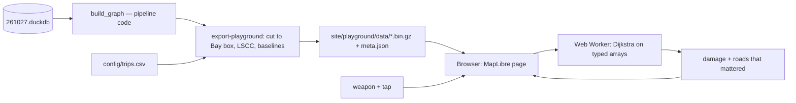
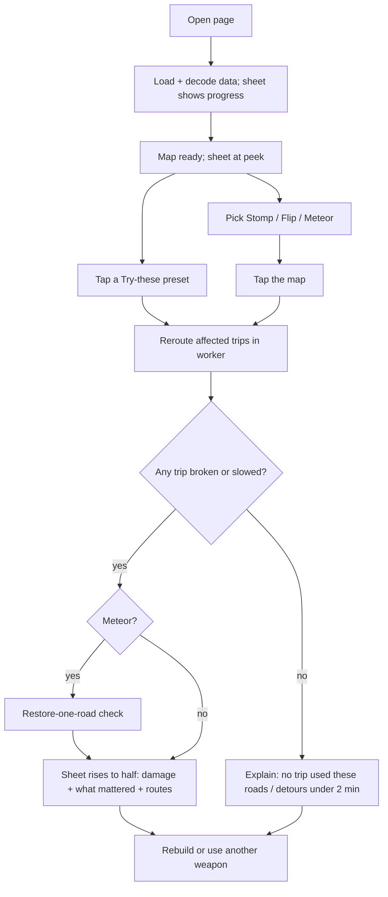

# route-impact — Fault playground (Phase 2) design

**Status:** draft, 2026-10-29 · **Owner:** Jared Narvaez · **Parent design:** [DESIGN.md](DESIGN.md)

> Numbers marked *(measured)* come from `bay_size.py`, a scratchpad script run on 2026-10-29 against the 261027 graph (`build_graph` on the real extract, cut to lat 37.2–38.1, lon −122.6 to −121.7). They are design evidence, not README numbers.

## 1. Abstract
A static web game where a visitor breaks real Bay Area roads and watches what happens to traffic. Pick a weapon (**Stomp** one road, **Flip** a one-way, or drop a **Meteor** that wipes out every road in a circle), tap the map, and the page reroutes a fixed set of trips in the browser. It shows which trips broke or got slower, how many minutes of delay you caused, and **which of the destroyed roads actually mattered**. Usually it's only a handful, because the road network is redundant. **Rebuild** puts everything back.

It's the daily pipeline's method (route trips before and after, compare, trace the cause), turned into something a person can play with in under a minute without installing anything. The interaction style (weapon toolbar, tap to destroy, score, rebuild) is inspired by [Campus Crusher](https://campuscrusher.com/); the look follows the Apple Maps iOS app (§5.9). No server: the graph ships as static files on GitHub Pages and routing runs in JavaScript.

## 2. Glossary
Terms from [DESIGN.md §2](DESIGN.md#2-glossary) (segment, edge, vertex, LSCC, trip, gravity weight) keep their meaning. New ones:

| Term | Meaning |
|---|---|
| **Playground** | The static page described here (`site/playground/`). |
| **Bay subgraph** | The NorCal routing graph cut to the Bay Area box, exported once from a snapshot. |
| **Weapon** | A kind of edit the visitor picks from the toolbar: Stomp, Flip, Meteor (MVP); Quake, Tornado (P3). Each maps to a fault type from DESIGN §5.9 (§5.5). |
| **Edit** | What one use of a weapon does to the graph: a set of edges deactivated (and, for Flip, reverse edges activated). The in-browser counterpart of a fault. |
| **Blast** | The set of OSM ways an area weapon (Meteor, Quake, Tornado) hits. |
| **Mattered** | A destroyed road whose restoration alone brings an affected trip back (no longer broken, delay under 2 min). The pipeline's counterfactual check (DESIGN §5.7) applied to one blast. |
| **Damage** | What the panel reports after an edit: trips broken and minutes of delay added. Shown as two plain numbers, not combined into a made-up score. |
| **Rebuild** | Reset: restore the original network. |
| **Baseline** | Trip routes and times on the unedited Bay subgraph, precomputed in Python and shipped with the page. |
| **Pick** | Finding the road under the visitor's tap. |
| **Sheet** | The Apple Maps-style card that slides up from the bottom of the screen and holds the toolbar and results (§5.9). |

## 3. Problem statement
### Current state
- The project's results are honest but quiet: five real days, all LOW, 0 broken trips. The interesting behavior — a broken bridge rerouting 100+ trips, the right culprit named — only shows up in `results/faults/261027/scores.json` and a README table.
- To see the tool *do* something, a visitor has to clone the repo, install Python 3.11 and DuckDB, download two 624 MB snapshots and wait about 7 minutes per comparison (`metrics.json`: 448.46 s wall). A recruiter will not do this.
- The existing results map (`site/index.html`) draws one day's affected trips. On real days it shows "No affected routes", because nothing broke.
- `route-impact what-if` already answers "what if this road were gone?", but only from the command line, on the full graph, in minutes.

### Desired state (needs, not solutions)
1. **A visitor understands what the project does within one minute,** without reading the README first.
2. **A visitor can test the tool's claim themselves:** pick a real road, break it, and see that the tool finds which trips changed and why. Seeing it work on a road *they* chose is more convincing than a table of injected-fault scores.
3. **The demo shows the project's real finding:** most single-road breaks change nothing because the network is redundant (impact rate 19/200 in the fault suite), while a few roads (bridges, chokepoints) matter a lot.
4. **It costs nothing to run and can't go down:** no server, no API keys, nothing to maintain between job applications.
5. **It stays consistent with the pipeline:** same graph rules (drivable list, speeds, one-way handling), so the playground isn't a separate toy that disagrees with the real tool.

## 4. Solution statement
### Comparable examples
*(A/B Street, OSRM and ngraph from memory, not re-checked. Campus Crusher played in a browser on 2026-10-29. Apple Maps from the iOS app.)*

| Example | What works | What doesn't / where it feels awkward |
|---|---|---|
| **Campus Crusher** (campuscrusher.com; smash real OSM campus buildings in 3D) | Instantly understandable: pick a weapon from a bottom toolbar (Meteor, Stomp, Quake, Tornado…), tap, things break, a score counts up, **Rebuild** resets. Real names on everything, real OpenStreetMap data. | The destruction has no consequence: nothing tells you *what* breaking a building means. Global counters and rankings need a backend. The 3D scene is heavy. |
| **Apple Maps (iOS)** | A calm, muted map that stays the focus. One draggable bottom **sheet** with three heights holds everything; small round floating buttons for map controls; system font; translucent blurred panels; one strong accent color for routes. | Its route and incident layers are polished but closed; nothing to reuse except the interaction patterns. |
| **A/B Street** (Dustin Carlino; Seattle traffic sim, runs in the browser via WebAssembly) | Edit a road (close a lane, change a turn) and immediately see the effect on trips — exactly the "break it, see the impact" loop. | Heavy: a large download and a game-like UI with many modes; it takes several minutes to learn. Too much for a one-minute visit. |
| **OSRM demo map** (map.project-osrm.org) | Instant feel: drag two points, route redraws in milliseconds. | Routing runs on a server, so a static clone isn't possible. You can't edit the map, so it shows routing, not impact. |
| **ngraph.path demo** (Andrei Kashcha; pathfinding on city road graphs in the browser) | Proves in-browser shortest paths on hundreds of thousands of vertices are interactive; ships the graph as a compact binary file instead of JSON. | Single route between two clicked points; no notion of "what changed". |

**Takeaways:** take Campus Crusher's game loop (weapon → tap → damage → rebuild), because it's understood in seconds. Take Apple Maps' layout and calm visual style, so the map and routes stay the focus and the game feels like a real maps app. Take A/B Street's idea that an edit has consequences for trips, and ngraph's compact binary graph. Then add what none of them has, which is this project's point: **why** a route changed, and which destroyed roads mattered.

### Functional requirements
1. **F1 — See the network:** a calm basemap of the Bay Area, the playground's trips as faint lines, and a one-line instruction in the sheet ("Pick a weapon and tap a road").
2. **F2 — Weapons (MVP):** a toolbar in the sheet with three weapons. They map to fault types from DESIGN §5.9 that affected trips in the suite: `delete_way`/`delete_bridge`, `flip_oneway` and `disconnect_node` together caused 14 of the 19 impactful faults (`results/faults/261027/scores.json`).
   - **Stomp:** tap a road, delete that OSM way.
   - **Flip:** tap a one-way road, reverse it (disabled on two-way roads, with the reason).
   - **Meteor:** tap anywhere, delete every way within a fixed radius of the tap.
   - Quake (disconnect every intersection in a circle) and Tornado (delete along a dragged line) come in P3. Speed edits (`bad_maxspeed`, `downgrade_class`) are left out: in the suite they affected 0 of 56 faults, so as weapons they would almost never do anything.
3. **F3 — Damage:** after an edit, reroute the affected trips and show **trips broken**, **trips slowed by 2 min or more** (the pipeline's `slow_seconds`, 120 s), and **added travel minutes across the sampled trips delayed ≥ 2 min** (seconds summed, then rounded for display), always next to the sample size ("of 2,0xx sampled trips"). Broken trips are counted separately and never added into the minutes. The page never presents this as total traffic delay or vehicle-minutes.
4. **F4 — What mattered:** draw affected trips (before vs after route). For Stomp and Flip the cause is that one road, by construction. For Meteor, list what **mattered** (§5.8) in three kinds: **single roads** whose restoration alone recovers a trip, **road groups** (a run of destroyed roads on one stretch, e.g. a bridge drawn as several ways) that recover it together, and trips explained only by **several separate roads together**. When the check was capped, affected trips are marked **"attribution incomplete"** instead of getting a verdict. Each road links to openstreetmap.org.
5. **F5 — One active edit, Rebuild:** a new edit replaces the current one; **Rebuild** restores the original network. (Stacking several edits and undo come in P3.)
6. **F6 — Explain "nothing happened" honestly:** distinguish **"no sampled trip used these roads"** from **"N trips rerouted, none slowed by 2 min or more"**. Both are common (181 of 200 suite faults affected no trip). Neither claims the edit is harmless: only the sampled trips were tested.
7. **F7 — Try these:** one-tap presets from `config/demo_faults.toml`: **Bay Bridge** (a labelled compound Stomp of its 10 ways) and **University Ave ramp** (Flip). A visitor sees real damage without hunting for a chokepoint.
8. **F8 — Apple Maps-style interface:** the layout and behavior in §5.9 — a full-screen map, a bottom sheet with three heights, floating round controls, and light and dark appearance.

### Non-functional requirements
- **N1 — Static only:** GitHub Pages, no server, no build step for visitors. Libraries from a CDN with pinned versions, as the results map already does.
- **N2 — Download size:** two separate limits. **Hard:** each committed file ≤ 5,000,000 B (the repo rule, DESIGN §5.10). **Target:** the playground's own data + code ≤ 10,000,000 B transferred (gzipped), excluding basemap tiles, which are third-party and cached. *Why 10 MB:* routing alone is 3,992,423 B gzipped *(measured)*, so 5 MB total is infeasible; 10 MB is roughly 3 s on a 25 Mbit/s connection. Measured on a cold load in P0, not assumed. *(measured: all-roads geometry alone is 5,201,441 B gzipped, so geometry must be reduced — §5.3.)*
- **N3 — Responsive edits:** a complete edit (find affected trips, reroute, the "what mattered" check, return to the page, draw) should finish in about 1 s on a laptop. The gate cases are **the Bay Bridge preset and the largest Meteor over downtown San Francisco**, the worst cases. *Unmeasured:* this is the main feasibility risk and is measured end to end in a real browser first (§7, P0).
- **N4 — Same graph rules as the pipeline:** the Bay subgraph is exported by Python from the pipeline's own `build_graph`, never rebuilt in JS.
- **N5 — Reproducible export:** one command builds the playground data from a named snapshot; the snapshot id and git commit are recorded in the data.
- **N6 — Tested against an oracle on the same graph:** the oracle is a **Python full recomputation on the identical exported graph, endpoints, costs and edit** — not the full-NorCal `what-if`, which differs in graph, trip set and endpoint handling. JS and the oracle must agree on trip ids, reachability, delays, broken/slowed classification and the "mattered" set, for Stomp, Flip and Meteor.
- **N7 — Phone first:** the sheet layout is designed for a phone and adapts to desktop (§5.9). Tap targets ≥ 44 px.
- **N8 — Visible loading and error states:** the page never shows a blank map; failed fetch, missing browser feature, or a worker error each produce a plain message.
- **N9 — Smooth map:** pan, zoom and drawing stay at interactive frame rates while routing runs. Routing happens in a Web Worker; drawing is GPU-rendered (§5.9).
- **N10 — Accessible:** the whole edit flow works without a pointer (crosshair + Enter, §5.9), results are announced to screen readers and are always readable as text, not only as colors on the map, and motion is reduced when the visitor asks for it (`prefers-reduced-motion`).

### Non-goals
- **Global counters, leaderboards, shared scores.** They need a backend (Campus Crusher has one); the playground is static. Damage is per visit.
- **3D.** A 2D map shows routes clearly; 3D buildings add download weight and nothing to what the tool proves.
- **Copying Apple's assets.** No Apple Maps tiles, SF Symbols icons or bundled SF Pro font (their licenses limit use to Apple platforms). The page borrows *layout and interaction patterns* only and uses the visitor's system font stack (SF on Apple devices, the native font elsewhere) and an open-source icon set.
- **Routing between arbitrary tapped points.** Trips stay fixed: the point is impact on a known set, not a navigation app.
- **All of NorCal.** The Bay box only (726,182 vertices statewide would not fit N2/N3).
- **Quake, Tornado, stacked edits with undo** in the Nov 4 scope (P3).
- **Agreement with the full-NorCal pipeline.** The playground uses pipeline road rules on a bounded graph; detours outside the box don't exist in it (§5.1).
- **Turn restrictions, traffic, live data** — same limits as the pipeline.
- **Saving or sharing edits** (no accounts, no backend). A URL hash for one edit is at most a later nicety (P4).
- **Matching the pipeline's numbers exactly on a real day.** The playground uses a cut graph and a subset of trips; it demonstrates the method, it doesn't replace `route-impact impact`.

## 5. Solution design



### 5.1 Export in Python, route in JavaScript
- **Decision — the graph is built by the pipeline's own `build_graph` and exported, never rebuilt in JS.** *Why:* need 5. The drivable list, access precedence, speeds and implied one-ways live in one place (AGENTS.md "keep each rule in one place"); a JS reimplementation would drift. *Cost:* the playground is pinned to one snapshot (261027), stated on the page.
- **Exporter:** `route-impact export-playground --snapshot 261027` → `site/playground/data/`. In this order: (1) **filter trips geographically** — keep only trips whose both raw coordinates lie in the Bay box, so no outside trip is pulled in by snapping; (2) cut the graph to the box: keep an edge only if both its end vertices are inside, so a contracted edge that leaves the box is dropped whole, never clipped; (3) snap the kept trips into the box's largest strongly connected component *(measured: 213,910 of 215,325 vertices)*; (4) **freeze** that trip cohort and its endpoints, and record every exclusion with a reason in `meta.json`, with snapshot id, git commit, box and counts. The LSCC is computed **once, on the unedited graph**; the edited graph is never filtered to its LSCC, which would hide breaks.
- **What the box changes (stated on the page):** these are the pipeline's road rules on a **bounded** graph. A detour that leaves the box doesn't exist here, so the playground can report a break or a longer delay where the full NorCal graph has an outside detour. That is a known difference, not a bug.

### 5.2 Data format: gzipped typed arrays
- **Decision — versioned binary typed arrays, gzipped, decompressed in the browser with the built-in `DecompressionStream('gzip')`.** *Why:* *(measured)* the routing arrays are 9,245,512 B raw but 3,992,423 B gzipped; committing the gzip keeps each file under the 5 MB limit with no decompression library. *Rejected:* GeoJSON/JSON (several times larger and slow to parse at 470K edges); relying on GitHub Pages to compress `.bin` (not guaranteed for binary types); chunking (meets the per-file rule but not the transfer budget). The files are fetched as stored gzip bytes and decompressed in the worker, which is where the feature is detected.
- **Format rules:** a `format_version` in `meta.json`; little-endian; dense vertex and edge indices as `Uint32`; **routing costs as `Float64`**, matching Python, so no tie or 120 s boundary flips from precision; **OSM ids as `Float64`** (exact up to 2^53; node ids already exceed 2^32); CSR offsets of length V+1.
- **Keep every parallel edge, not just the winner.** The pipeline's CSR matrix keeps only the fastest edge per (u, v) (DESIGN §5.4), and routing through it is fine for one snapshot. But if an edit deletes that winner, the next-fastest road between the same two junctions is a real detour, and a winner-only export would report a false break. So the export has **one row per pipeline `Edge`**, with a stable edge id, source, target, seconds, way id, and an index into the drawing geometry. Dijkstra relaxes all active edges, so parallel roads are handled naturally.
- **Flip without rewriting CSR:** for every edge of a one-way way, the export also emits its reverse twin, marked **inactive**, in the reverse direction's adjacency row. A flip deactivates the forward edges and activates the twins. Edits are an active-mask overlay (`Uint8` per edge), so Reset just restores the mask, and a reverse twin that parallels an existing edge is simply one more parallel edge.

### 5.3 Geometry: pick roads, find blasts, draw only what matters
- **Decision — don't draw the whole network.** The basemap already shows every road. The page draws only the selected road, the blast, affected trips (before and after) and the roads that mattered. *Why:* 276,859 polylines *(measured)* add weight and clutter for nothing the basemap doesn't already show.
- **Geometry is still shipped, for picking and blasts:** a uniform grid index built on load answers both "which road is under this tap" (Stomp, Flip) and "which roads are within this radius" (Meteor). *(measured: all-road geometry is 5,201,441 B gzipped — over budget.)* Reduce it before shipping: simplify polylines (Douglas–Peucker at a few metres) and quantize coordinates to integers. Target ≤ 5 MB per file and the total within N2; the savings are **measured in P0, not assumed**.

### 5.4 Baselines precomputed; incremental reroute in the browser
- **Decision — ship each trip's baseline route (time + list of edge ids), computed in Python on the exported graph.** *Why:* the local trips have 1,184 distinct origins *(measured)*, so computing baselines on load would be ~1,200 shortest-path searches per page view. The size of the path lists is unmeasured (P0, inside the 10 MB target). An index from edge id → trips that use it is built on load.
- **After an edit, reroute only trips whose baseline path uses a deactivated edge** — the pipeline's incremental rule (DESIGN §5.6). **What this guarantees:** exact detection of trips that **break or get slower**. If none of a trip's baseline edges was deactivated, its baseline path still exists at the same cost, and since endpoints are fixed (below), the trip can't get worse. **What it doesn't guarantee:** a flip also *activates* reverse edges, which may make some untouched trip faster. Those trips keep their baseline time, so the page reports worsening only, exactly like the pipeline. A test compares incremental vs full worsening classification after both delete and flip.
- **Endpoint semantics — fixed endpoints:** an edit only deactivates edges; vertices and trip endpoints never move. A trip whose endpoint loses all its edges is **broken**. This deliberately differs from the CLI, which rebuilds the graph and may apply the 200 m fallback snap (DESIGN §5.5). The playground oracle uses the same fixed-endpoint rule, and the page doesn't claim CLI equivalence.
- **Dijkstra runs in a Web Worker** (binary heap). Affected trips are **grouped by origin**: one search per origin, stopping once all that origin's destinations are settled, or when the reachable graph is exhausted (the slow case — a break). Each request carries a request id, and the page ignores any response whose id isn't the latest, so a slow result can't overwrite a Reset or a newer edit. Typed-array buffers are transferred once at load, not copied per edit.

### 5.5 Weapons
| Weapon | Phase | Graph change | Fault type (DESIGN §5.9) | Offered when |
|---|---|---|---|---|
| **Stomp** | MVP | deactivate every directed edge of the tapped OSM way | `delete_way` | a road is within tap distance |
| **Flip** | MVP | deactivate the way's edges, activate their reverse twins | `flip_oneway` | the way is one-way; disabled with a reason otherwise |
| **Meteor** | MVP | deletes **entire OSM ways** that intersect the circle of radius *r* (a segment-to-circle test in metres, so a segment crossing the circle counts even if both its points lie outside). A long way is deleted whole, even its parts beyond the ring; the drawn blast highlights all of it | `delete_way` × many | always (a tap on water hits nothing and says so) |
| **Quake** | P3 | at every vertex within *r*, only continue on the way you arrived on | `disconnect_node` × many | always |
| **Tornado** | P3 | Stomp every way crossed by a dragged line | `delete_way` × many | drag of ≥ some minimum length |

- **Hit test uses the shipped (simplified) geometry,** with the simplification tolerance recorded in `meta.json`. Roads within that tolerance of the ring's edge may differ from the unsimplified map. The oracle runs on the same shipped geometry, so the tests check the browser, not the simplification.
- **Meteor radius:** one fixed radius in the MVP, chosen in P0 from 150 / 300 / 500 m against the frozen stress set (§7). Not guessed here.
- **One active edit** (MVP): each weapon use replaces the previous edit; a preset is one compound edit. Stacking and undo come in P3.
- Quake needs a small change to Dijkstra (state = vertex + incoming way at the affected vertices), so it waits for P3.

### 5.6 How each functional requirement is met
| Req | How |
|---|---|
| F1 | MapLibre map with a muted vector basemap (§5.9), Bay box outline, trips as faint lines, instruction in the sheet |
| F2 | Weapon toolbar in the sheet; grid-index pick / radius query → edge mask change |
| F3 | Worker reroutes affected trips, grouped by origin; counts use `slow_seconds` from `meta.json` (copied from `config/thresholds.toml`); delay minutes summed over slowed trips |
| F4 | Before (grey) and after (accent color) routes for affected trips, capped at 25 like the pipeline's map; "roads that mattered" list from §5.8, each tappable to highlight it, with an OSM link |
| F5 | One active-edit mask; a new edit resets the mask first; Rebuild restores the original mask and cancels any in-flight request |
| F6 | No trip's baseline used a deactivated edge → "No sampled trip used these roads". Some rerouted, none ≥ 2 min slower → "N trips rerouted, none slowed by 2 min or more" |
| F7 | "Try these" row in the sheet: `bay_bridge` (compound Stomp, 10 ways) and `university_ramp` (Flip) from `config/demo_faults.toml`, exported into `meta.json` with any way outside the box reported; `ashby_junction` returns as a Quake preset in P3 |
| F8 | §5.9 |

### 5.7 Edge cases
- **Tapped far from any road (Stomp/Flip):** nothing selected, with a hint to zoom in.
- **Meteor hits no road** (water, a park): "Missed — no roads here"; nothing is rerouted.
- **Meteor hits a trip endpoint's roads:** that trip is broken (fixed endpoints, §5.4) and is listed as such.
- **Edit splits the network:** trips to the cut-off part become **broken** (no route), not dropped — the case the tool exists to catch.
- **Road cut by the box edge:** only the inside part exists; trips are fully inside the box, so this only changes which detours exist. Stated on the page.
- **Old browser without `DecompressionStream` or Web Workers:** detected in the worker / on load; show a plain message naming the supported browsers instead of a blank map.
- **Fetch or worker failure:** visible error with a Retry button (N8).
- **Flip on a two-way road:** Flip is unavailable for that road, with "this road is two-way".
- **No WebGL** (MapLibre needs it): plain message instead of a blank map (N8).
- **Phone:** tap targets ≥ 44 px; the sheet never covers the blast — the map pans so the tap point stays visible above the sheet; slower routing is acceptable.

### 5.8 What mattered (counterfactual check for one blast)
A Meteor can destroy dozens of roads at once, and usually only a few of them matter. Finding those few is the pipeline's root-cause rule (DESIGN §5.7), applied to one edit, with the same definitions:
1. **Affected trips** = trips whose baseline path uses a deactivated edge and which broke or slowed by ≥ 2 min.
2. **Candidates for a trip** = the destroyed ways on its baseline path.
3. **"Recovers" means what the pipeline means:** a **broken** trip recovers when it becomes reachable again; a **slowed** trip recovers when its delay drops below `slow_seconds`. (So restoring a road that turns a break into a 5-minute detour *does* count as mattering for that broken trip.) A fixture pins this case.
4. **Single roads:** for each candidate way *w*, reactivate only *w*'s edges and reroute the affected trips that have *w* as a candidate. A recovering trip confirms *w*.
5. **Road groups:** for trips no single road recovers, split the trip's baseline path into **maximal runs of changed segments, separated by any unchanged segment** (DESIGN §5.7), and test each run with ≥ 2 ways, maximal runs only. *Why the separator matters:* the Bay Bridge's two spans are split by the intact Yerba Buena tunnel, so they are two runs, not one.
6. **Otherwise:** "several separate roads together", listing the candidates. Never forced onto one road.

**Per-trip bookkeeping:** confirmed singles, confirmed runs, tested candidates, unchecked candidates.
- **Cost:** one grouped reroute per (candidate way, origin) pair, plus one per (run, origin) pair.
- **Cap:** one total attribution budget (number of searches), set in P0 from the stress set. When the budget runs out, checking continues in order of trips affected, and every trip with untested singles or runs is shown as **"attribution incomplete"**, never as "several roads together". A step-6 verdict is only given when steps 4–5 were complete for that trip.
- **Stomp and Flip** skip this: the cause is the one road by construction.
- **The oracle** (N6) runs the same steps in Python, **uncapped**. Tests compare the browser's *confirmed* singles and runs against the oracle (they must be a subset, and equal when the cap isn't hit), and a dedicated fixture forces the cap to check the "attribution incomplete" path.

### 5.9 Interface: Apple Maps patterns
**Decision — MapLibre GL JS with free OpenFreeMap vector tiles, instead of Leaflet with raster OSM tiles.** *Why:* the Apple Maps feel depends on a calm, restyled map (muted colors, roads and labels de-emphasized so the routes stand out), smooth fractional zoom, rotation, and a matching dark style. Raster tiles can't be restyled. MapLibre also draws the routes and blasts on the GPU, which serves N9. *Cost:* a larger library than Leaflet (size measured in P0), WebGL required (fallback message, §5.7), and a second map library in the repo (the existing results map stays on Leaflet). *Use the provider's ready-made styles* (a light and a dark one) with only small color tweaks for the MVP; a fully custom Apple-like style is P4.

**Attribution is part of the layout.** The tile credits (OpenFreeMap, OpenMapTiles, © OpenStreetMap contributors, per OpenFreeMap's guide) stay visible above the sheet at every sheet height, never hidden behind it. P0 records the chosen style's license, the icon set's license, and the policy of the fallback (OSM's own raster tiles, whose usage policy forbids obscuring attribution and limits heavy use).

Patterns taken from Apple Maps (layout and behavior only; no Apple assets, see Non-goals):
- **Full-screen map;** everything else floats above it.
- **Bottom sheet with three heights:** *peek* (weapon toolbar + one line of status), *half* (damage numbers, roads that mattered, Try these), *full* (list of affected trips with before/after times). In the MVP, height changes by **tapping the grabber or labelled height buttons**; drag with momentum is P4. On desktop (≥ 900 px wide) the sheet becomes a floating card on the left, like Apple Maps on Mac and iPad.
- **Materials:** translucent blurred background on the sheet and buttons (`backdrop-filter`), large corner radius, soft shadow, thin separators.
- **Floating round buttons** top-right: Rebuild, recenter on the Bay, light/dark toggle.
- **Type:** the system font stack (`-apple-system, system-ui, …`), so it's SF on Apple devices and native elsewhere; large bold numbers for damage, as Apple Maps does for ETAs.
- **Weapon toolbar:** a segmented row of icon + label buttons (open-source icon set) in the sheet's peek height, with the selected weapon highlighted in the accent color.
- **Color:** one accent blue for "after" routes and selection; grey for "before" routes; red for broken, orange for slowed — always paired with text, never color alone (N10).
- **Feedback:** a Meteor shows a simple expanding ring where it lands (CSS/MapLibre layer); routes redraw. Richer animation is P4. All motion is reduced under `prefers-reduced-motion`.
- **Without a pointer:** a crosshair marks the map center. Arrow keys pan, and **Enter fires the selected weapon at the crosshair** (Stomp/Flip take the road nearest it). Results are announced through a polite live region, focus is always visible, and the sheet heights are buttons. P2 verifies the full flow — pick weapon, fire, read damage, Rebuild — by keyboard only.
- **Light and dark:** follows the system setting, with a matching dark map style.

### 5.10 Exact fast routing: customizable contraction hierarchies (P0c)
*Why:* P0b's clean browser run (`results/playground/feasibility.json`) showed plain Dijkstra + landmarks + 8 workers still needs 2.7–6.5 s for a full explanation at the Bay Bridge toll plaza, plus ~1.9 s of landmark setup and an unmeasured 8× memory cost. Jared chose CCH over progressive results (PLAN decision 14).

**How CCH works:**
1. **Order (offline, once):** rank every intersection by a nested-dissection order. Small separators, such as the few roads crossing a bridge or a ridge, go last.
2. **Shortcut structure (topology):** "contract" intersections in that order, adding a shortcut wherever removing one would disconnect its neighbours. This depends only on the order, not on travel times.
3. **Customization:** fill every shortcut's travel time bottom-up from the real edge times (the lower triangles).
4. **Query:** an exact shortest path is found by searching *upward* in rank from both ends and meeting in the middle, typically touching a few hundred intersections instead of tens of thousands.

**Decisions** (revised after the Codex critique of 2026-10-29; see PLAN Review log):
- **Order offline with RoutingKit** (BSD-2, by CCH's authors; inertial-flow nested dissection on vertex coordinates), via a small C++ program in `scripts/cch_order/` at a pinned RoutingKit commit.
  - *Reproducibility:* the input is canonical (vertices in export order, undirected deduplicated edge list sorted by (min, max), coordinates as fixed microdegrees). The compiler and flags are recorded, and the output is validated as a permutation of 0..V−1.
  - `order_manifest.json` records the RoutingKit commit, compiler, flags and SHA-256 of input and output.
  - *Why RoutingKit:* the reference implementation; our own partitioner would be the riskiest code in the project.
  - *Rejected:* all of RoutingKit in WebAssembly (adds a toolchain and blobs for steps that are simple in JS); METIS (another native dependency, not CCH's own method).
- **Topology = the fill graph:** eliminate vertices in rank order, making **all remaining higher-ranked neighbours of each vertex a clique**, regardless of weights or alternative paths. With that construction, **any** permutation gives correct distances; only speed depends on the order. Tests use several trivial permutations; CI never needs C++.
- **Directed metrics:** every CCH arc {x, y} stores an upward and a downward weight. For ranks z < x < y, `x→y` relaxes through `x→z→y` and `y→x` through `y→z→x`. Lower triangles are processed in increasing rank of the arc's lower endpoint, so dependencies are final. Each direction keeps ∞ where no input arc exists, so a later Flip can make it finite.
- **Partial re-customization** (the CCH paper's update procedure; *not* a running `min` that would keep stale cheap shortcuts after deletions):
  1. For each changed input arc, recompute its CCH arc's **direct-input minimum** over its currently active parallel input arcs, and enqueue that arc.
  2. Pop arcs in increasing lower-endpoint rank. Recompute both directional weights **from scratch** = min(direct-input minimum, every lower triangle).
  3. If a directional weight changed, enqueue every arc whose lower triangles use it, transitively.
  4. **Undo and Rebuild** run the same procedure (or restore a saved base copy for Rebuild).
  5. Tests check partial == full customization after every transition.
- **Integer milliseconds, rounded once in Python:** `ms = floor(seconds × 1000 + 0.5)`, computed by the exporter and shipped as `Uint32`. JS never rounds.
  - **Arithmetic in `Float64` holding whole milliseconds** (revised 2026-10-29). The CCH metrics are `Float64Array`s whose finite values are always integers; **infinity is JavaScript's `Infinity`**. *Why:* integer sums are exact below 2⁵³, and the bound is checked at build time (the sum of all finite input ms must be ≤ `Number.MAX_SAFE_INTEGER`). The first design used a `Uint32` sentinel with a "sum of all weights < 2³² − 1" bound, but the Bay graph's finite weights sum to 4,813,448,868 ms, so the P0c-2 checkpoint stopped. `Float64` removes the sentinel and the guarded addition at ~7.5 MB extra. Shipped edge times stay `Uint32` (each edge is far below 2³² ms).
  - Zero-ms edges are allowed.
  - *Disclosure:* answers are exact **relative to the quantized playground graph**. Against the pipeline's Float64 seconds, a trip can cross the 120,000 ms threshold, and baseline paths, candidate sets and attribution can change. P0c reports every such difference against the Float64 P0b reference, and the page states that times are rounded to the millisecond.
  - Baselines and presets are recomputed in Python on the integer graph.
- **Parallel arcs:** several input arcs can map to one CCH arc; the direct-input minimum is over the *active* ones, so deleting a parallel winner exposes the next one.
- **Path unpacking:** **direction-specific witnesses** per CCH arc: either the winning input edge, or the two directed child arcs of the winning triangle. They're refreshed whenever a weight or an equal-cost winner changes, and restored on undo and Rebuild. Unpacked paths are asserted to be continuous, use only active edges, and sum exactly to the distance. Attribution candidates always come from the **shipped baseline path**, never from a CCH re-unpacking.
- **Batched counterfactuals:** for each restored way or run, re-customize once, query all trips that share it, then undo once. The toll-plaza case is benchmarked first (P0c-2 checkpoint), before the full integration.
- **Size and memory:** fill-arc and triangle counts and explicit buffer bytes (topology, two metrics, witnesses, saved base, construction temporaries) are measured before choosing between shipping the topology (chunked under 5 MB per file) and building it in the browser.
  - Load-time and memory limits are set in PLAN P0c.
  - Drop what the browser no longer needs: vertex coordinates and OSM ids, `edge_source`, landmark tables, the exclusion list in `meta.json`.
- **Fallback at the P0c cutoff (PLAN):** progressive results (numbers first, explanation streamed), recorded as an explicit gate change. Nothing is cut.

## 6. Solution implementation
### 6.1 Mockup (phone; sheet at half height after a Meteor)
```
┌─────────────────────────────┐
│                       ( ↺ ) │  ← floating round buttons:
│   muted vector map    ( ◎ ) │    Rebuild, recenter, light/dark
│                       ( ◐ ) │
│        ╭─────╮              │
│   ~~~~ │ ✕ ✕ │ ~~~~         │  ← blast ring; destroyed roads fade
│        ╰─────╯              │
│   ━━━━ grey: before routes  │
│   ━━━━ blue: after routes   │
├─────────────────────────────┤
│            ───              │  ← grabber
│ [Stomp] [Flip] [Meteor]     │  ← weapon toolbar (peek height)
│ Meteor hit 37 roads         │
│                             │
│  12        4         58 min │  ← big bold damage numbers
│  broken    slowed    added  │
│ ─────────────────────────── │
│ Roads that mattered (2)     │
│  I-80 Bay Bridge   9 trips ›│
│  Bryant St         3 trips ›│
│ Several roads together: 2   │
│ ─────────────────────────── │
│ Try these: [Bay Bridge]     │
│            [University ramp]│
│ Snapshot 261027 · routed    │
│ in your browser · © OSM     │
└─────────────────────────────┘
```
*(All counts and road names in the mockup are placeholders, not results.)* On desktop, the same sheet is a floating card on the left over a full-window map.

### 6.2 User flow


## 7. Proposed plan / timeline
Work on a branch (`playground`) so `main`, which job applications link to from Nov 4, stays stable; merge only after P2's Verify passes.

- **P0 — Feasibility spike (two go/no-go decisions), Oct 30.** Export the real Bay arrays in the §5.2 format (all parallel edges, reverse twins, Float64 costs), baseline paths and reduced geometry. Build a bare MapLibre page and measure **in a real browser** (Claude's browser pane, page served locally). Results go to a committed `results/playground/feasibility.json`.
  - **Frozen stress set**, fixed before measuring and committed with the results: the Bay Bridge preset; the University ramp; 20 seeded random Stomps; Meteors at 150 / 300 / 500 m on four fixed spots chosen to cover the worst cases — dense downtown SF streets, a chokepoint (a bridge approach), a spot that isolates trip endpoints, and a quiet residential area.
  - **Per case, recorded:** affected trips and origins, single and run searches, whether attribution completed, and end-to-end latency (lookup + grouped reroute + attribution + message + draw) as the median of 5 repeats.
  - **Also recorded:** cold-load bytes (excluding tiles, including MapLibre), decode time, peak JS heap, per-file gzipped size, and the licenses and attribution of the tiles, style and icons.

  **Decision A — live routing:** go if every file ≤ 5,000,000 B, the total ≤ 10,000,000 B, and the Bay Bridge preset and every Stomp finish in ≤ 2 s (1 s target). If not, shrink the box (SF + Oakland) or the local-trip sample and re-measure once. If it still fails, the Nov 4 page ships **labelled precomputed results for the presets only** (no live routing).
  **Decision B — Meteor:** given A passes, the radius is the largest one whose stress cases all finish in ≤ 2 s within one total attribution budget. If no radius passes, Meteor is dropped from Nov 4 and Stomp/Flip ship live.
- **P1 — Exporter + oracle + tests.** `route-impact export-playground`. pytest on fixtures: counts, parallel edges kept, reverse twins, exclusions recorded, baselines equal Python routing. A **Python oracle** that applies a Stomp, Flip or Meteor edit to the exported graph, fully recomputes every trip under fixed-endpoint semantics, and computes the uncapped "mattered" set (§5.8). `node --test` checks that the JS routing core agrees with the oracle on trip ids, reachability, delays, classification and the mattered set, on these fixtures: Stomp, Flip, delete-the-parallel-winner, flip-into-an-existing-edge, a Meteor where one road matters, a Meteor needing a contiguous run, a "several roads together" case, and trips at exactly 120 s. Node is preinstalled on GitHub runners; no npm packages.
- **P2 — Game MVP.** Full-screen MapLibre map with muted light and dark styles; bottom sheet with three heights (desktop: left card); floating Rebuild / recenter / theme buttons; Stomp, Flip, Meteor; grouped reroute in a worker with request ids; damage numbers; drawn before/after routes; roads that mattered; Try these presets; the two "nothing happened" messages; loading/error states; keyboard and reduced-motion support. **Verify:** browser == oracle on both presets, 10 random Stomps and 3 Meteors (damage numbers and mattered set); a smoke test on the deployed Pages URL on a phone-sized and a desktop viewport (loads, presets run, no console errors). Then link it from the README.
- **P3 — More weapons:** Quake, Tornado, stacked edits with undo, Ashby junction as a Quake preset.
- **P4 — Polish:** URL hash to share one edit, animation and phone pass.

**Timeline (revised 2026-10-29, PLAN decision 13):** P0 showed plain Dijkstra misses the gate at chokepoints. Nothing is cut: the whole Bay box, free-aim Meteor and "roads that mattered" all stay. Next comes faster exact routing, P0b (landmarks/ALT + parallel workers), then P0c (CCH via WebAssembly) only if P0b's numbers fall short. Then P1–P2 at full scope. The playground launches when it passes the unchanged 2 s gate, targeting ~Nov 17. The Nov 4 applications use the finished MVP. P3–P4 follow.
